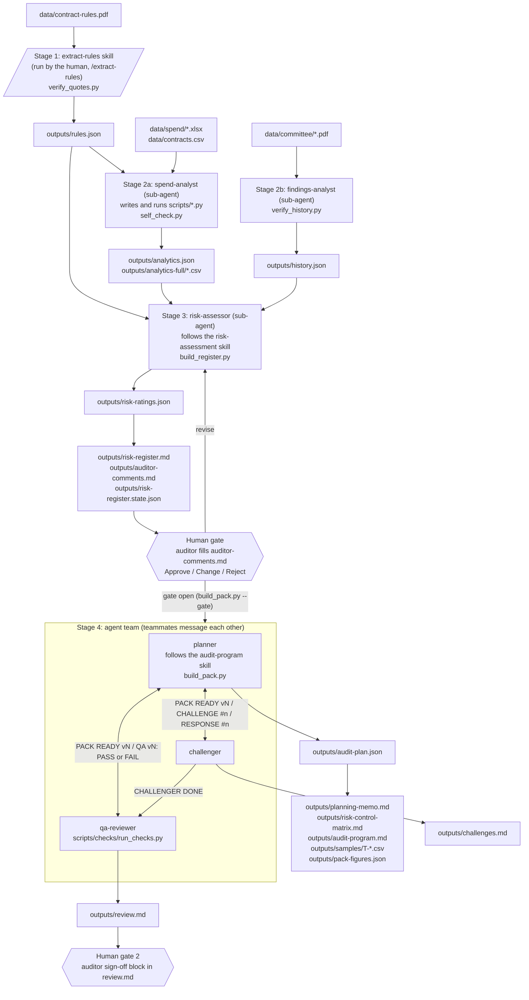

# Procurement Audit Planner

Part A of HW2 (MGMTMSA 440). A Claude Code project built by following the 27-step guide at [procurement-audit-planner.vercel.app](https://procurement-audit-planner.vercel.app/): three skills, six agents, one human gate, one agent team.

## What it does

The system plans an internal audit of procurement at West Berkshire Council from the council's public data: its Contract Procedure Rules, three months of spend over £500, its Contracts Finder notices, and four Governance Committee papers. It turns the rulebook into testable rules, runs the full spend population against them, folds in past audit history, rates the risks, stops for a human auditor to approve the register, then turns the approved risks into a checked audit plan.

Two rules hold at every stage. Outputs describe indicators to investigate, never wrongdoing by the council, a service or a supplier. And Python computes every number: the agents read, classify and judge, while scripts compute, render and verify.

## Architecture



Stage 2a and 2b run in parallel. Everything else is sequential, because each stage reads the file the previous one wrote.

## Skills

A skill is a method file (`SKILL.md`) plus a script that checks or renders the result. The agent that loads a skill writes a JSON file of judgments; the script turns that JSON into the document and refuses to write anything if a citation does not resolve or a number was typed by hand.

| Skill | Who runs it | Input → output | Checking script |
|---|---|---|---|
| `extract-rules` | The human, with `/extract-rules` in the main session. No agent. | `data/contract-rules.pdf` → `outputs/rules.json` (rules with clause, page, thresholds and a verbatim quote; an `excluded` list with reasons; `notes` for contradictions and gaps; threshold `parameters` left null when the PDF defers the figure to the intranet) | `.claude/skills/extract-rules/verify_quotes.py`: schema, sequential IDs, thresholds against printed text, clause coverage, every quote found on its stated page. `--inventory` lists the PDF's clauses. Tests in `tests/test_verify_quotes.py`. |
| `risk-assessment` | The `risk-assessor` sub-agent (declared in its `skills:` frontmatter) | `rules.json` + `analytics.json` + `history.json` → `outputs/risk-ratings.json` (likelihood and impact scores with cited justifications, `{{$.path}}` placeholders instead of typed figures) | `.claude/skills/risk-assessment/build_register.py`: resolves every `[rule:]`, `[metric:]`, `[history:]` citation, fills placeholders from `analytics.json`, computes score and band from the council's own method, enforces the likelihood rubric, drops any risk with no resolvable citation, and renders `risk-register.md`, `auditor-comments.md` and the state file. On a revision it diffs against the state file and fails if anything changed that the auditor did not ask for. Tests in `tests/test_build_register.py`. |
| `audit-program` | The `planner` teammate (declared in its `skills:` frontmatter) | approved register + `rules.json` + `analytics.json` + `analytics-full/` → `outputs/audit-plan.json` (controls, test steps, sample recipes, PBC items, rules not tested, memo prose) | `.claude/skills/audit-program/build_pack.py`: checks the gate, resolves citations, draws every sample deterministically from the recipe, checks each sampled row exists in `spend_clean.csv`, sizes samples by risk score, confirms every rule is cited or in `not_tested`, and renders the memo, the matrix, the program, `samples/T-*.csv` and `pack-figures.json`. `--gate` runs only the gate check. Tests in `tests/test_build_pack.py`. |

The three scripts share one citation, placeholder and decision parser (`build_register.py` exports it; `build_pack.py` and `scripts/checks/qa_common.py` import it), so the QA checks read citations the same way the builders do.

## Agents

All six live in `.claude/agents/*.md`. Each has `memory: project`, so lessons about how to do the work (a parsing quirk, a citation path that failed) persist in `.claude/agent-memory/<name>/`; findings and figures never go there.

| Agent | Kind | Tools | Input → output |
|---|---|---|---|
| `spend-analyst` | Sub-agent | Read, Write, Edit, Bash, Glob, Grep | `rules.json`, `data/spend/*.xlsx`, `data/contracts.csv` → `outputs/analytics.json`, `outputs/analytics-full/*.csv`, and the scripts it writes in `scripts/` (`clean.py`, `contracts.py`, `analyse.py`, `self_check.py`, `tags.py`, `common.py`). Thresholds come from `rules.json`, never hardcoded. |
| `findings-analyst` | Sub-agent | Read, Write, Edit, Bash, Glob, Grep | `data/committee/*.pdf` → `outputs/history.json` (audit opinions, agreed actions, risk themes, the council's scoring method, discrepancies, gaps; every entry with file, page and a copy-exact quote). Verified by `scripts/verify_history.py`. |
| `risk-assessor` | Sub-agent, loads `risk-assessment` | Read, Write, Edit, Bash, Glob, Grep | `rules.json` + `analytics.json` + `history.json` → `outputs/risk-ratings.json`, then runs `build_register.py`. Recommends only; re-run after the gate to apply the auditor's decisions as a revision. |
| `planner` | Teammate, loads `audit-program` | Read, Write, Edit, Bash, Glob, Grep, SendMessage | approved register → `outputs/audit-plan.json`, then runs `build_pack.py`. Announces `PACK READY vN`; answers each challenge `accepted`, `declined` or `for the auditor`; fixes QA failures; sends `PLANNER DONE vN`. |
| `challenger` | Teammate | Read, Write, Edit, Bash, Glob, Grep, SendMessage | register, decisions, evidence files, the planner's pack → `outputs/challenges.md`. At most eight challenges in round 1 and four in round 2, each with a type, a risk, a resolving citation and one ask. Rating and scope points go to the auditor, not the planner. |
| `qa-reviewer` | Teammate | Read, Write, Bash, Glob, Grep, SendMessage | every pack version → `outputs/review.md`. Runs `scripts/checks/run_checks.py` (quotes, numbers, trace, samples), relays each failure to the planner as printed, holds sign-off until all four pass. Fixes nothing. |

### Sub-agents vs the agent team

The three Phase 1 agents are sub-agents. The main session launches each one, it works in its own context window, and it reports back a short summary. That isolation is the point: the spend-analyst reads aggregates of 10,607 rows and the findings-analyst reads four PDFs, and none of that enters the lead's context. Sub-agents cannot talk to each other, which is fine here because they only share files, and the spend-analyst and findings-analyst can run at the same time since neither needs the other's output.

The three Phase 3 agents are teammates in an agent team. The planner, challenger and qa-reviewer coordinate by `SendMessage`, addressed by name, without the lead relaying anything: the challenger sends `CHALLENGE #n` to the planner, the planner replies `RESPONSE #n`, the qa-reviewer sends `QA vN: FAIL ...` and the planner rebuilds. The lead runs the gate check, spawns the three, answers questions, and shuts them down when it has `PLANNER DONE`, `CHALLENGER DONE` and `QA DONE`. Agent teams are an experimental feature, switched on for this project by `CLAUDE_CODE_EXPERIMENTAL_AGENT_TEAMS=1` in the `env` block of `.claude/settings.json` (Claude Code 2.1.224 or newer).

## How they work together

**Sequential where one stage needs the last one's file; parallel where it doesn't.** `extract-rules` must finish first, because the spend-analyst parameterises every threshold from `rules.json`. The spend-analyst and the findings-analyst have no shared input, so they run in parallel. The risk-assessor needs all three JSON files. The team needs an approved register, and the gate check stops it from starting without one.

**Shared files are the coordination layer.** No agent passes data to another in a message. Each agent writes exactly one file of judgments (`rules.json`, `analytics.json`, `history.json`, `risk-ratings.json`, `audit-plan.json`, `challenges.md`, `review.md`) and reads the files of the agents before it. Citations are the join keys: `[rule:CPR-65]` points into `rules.json`, `[metric:$.tests.off_contract.counts.total]` into `analytics.json`, `[history:A-01]` into `history.json`. The builders resolve them; the QA checks resolve them again.

**A verifier sits at every stage.** Each agent is told it is done only when its script prints PASS or BUILT with zero warnings.

| Stage | Judgment file | Script that checks it | What it refuses |
|---|---|---|---|
| Rules | `rules.json` | `verify_quotes.py` | a quote not on its page, a threshold not printed in the quoted text, a clause neither ruled nor excluded |
| Spend | `analytics.json` | `scripts/self_check.py` | a flagged item that cannot be re-derived from the raw workbook cell on an independent code path |
| History | `history.json` | `scripts/verify_history.py` | a quote or table cell not on its page, an invented field, an empty section with no declared gap |
| Register | `risk-ratings.json` | `build_register.py` | a justification with no citation, a typed figure, an accusing word, a likelihood score the rubric does not support, a change the auditor did not ask for |
| Pack | `audit-plan.json` | `build_pack.py` | a closed gate, a sampled transaction not in the spend data, a control with no test, a rule neither cited nor listed as not tested |
| Whole pack | the three documents + samples | `scripts/checks/run_checks.py` | any failure in `check_quotes`, `check_numbers`, `check_trace` or `check_samples` |

The human gate sits between the register and the pack. `auditor-comments.md` is written by the builder with blank Decision cells; the auditor fills in Approve, Change or Reject; the risk-assessor applies exactly those decisions as a numbered revision; `build_pack.py --gate` refuses to open until every rated risk has a decision applied in a revision.

## Results

Numbers below are read from the files in `outputs/`.

**Rules** (`rules.json`, verified by `check_quotes`): 80 rules, 43 excluded clauses, 34 notes, 5 threshold parameters left null (the PDF defers them to the Procurement intranet). Tiers found in the rules: £1,000, £25,000, £500,000, £2.5 million. Quote threshold £25,000 from CPR-65; publication threshold £25,000 from CPR-66.

**Spend** (`analytics.json`): 3 monthly workbooks, May to July 2026. 10,607 rows read (£80,427,254); 8,524 rows analysed (£66,122,640) after excluding 2,015 redacted-supplier rows, 15 pension rows and 53 public-body rows. `contracts.csv`: 150 raw rows, 141 for the council, 61 notices live in the window. Self-check: PASS.

| Test | Flagged |
|---|---|
| threshold_clustering | 368 payments |
| split_purchases | 508 groups |
| off_contract | 637 suppliers |
| duplicates | 783 items: 527 within one payment run (same timestamp), 256 on different dates |
| expired_notice_spend | 7 suppliers |
| spend_vs_award | 7 suppliers |
| high_value_suppliers (population, not a signal) | 672 suppliers |

**History** (`history.json`): 20 audits (16 completed, 3 follow-ups, 1 advisory), 0 agreed actions listed in any paper, 23 risk themes, 12 discrepancies, 7 gaps. The council's scoring method was found in the Risk Management Strategy 2024-27. The Strategic Risk Register is exempt and not public; recorded as a gap.

**Register** (`risk-register.md`, revision 3): 9 risks rated, all in scope. R-07 (repeat payments of the same amount within a week) scores 15, Extreme. R-09 (waivers) scores 6, Moderate. The other seven score 8 to 12, Medium - High. Decisions in `auditor-comments.md` (2026-10-09): 7 Approve, R-04 Change (population narrowed to suppliers outside the placement tag, so placements are tested once under R-08 while grants, premises and agency staff stay in R-04), R-09 Change (likelihood 3 to 2), and a GENERAL row that rejects a separate grants risk (R-10) and puts schools' own purchasing out of scope. Gate line: `GATE OPEN on register revision 3`.

The gate ran twice. Revision 1 and 2 applied the first decisions (2026-10-08). The first team run then raised two points for the auditor: #5, whether the Limited Assurance opinion on Direct Payments (A-16) should raise R-08's likelihood to 4, and #8, whether schools' purchasing is in scope. The auditor answered both in revision 3 (R-08 stays at 3; schools out of scope), together with the R-04 and R-09 changes, and the team ran again on revision 3. The first run's `challenges.md` and `review.md` are in the first commit of this repo.

**Pack** (`pack-figures.json`, v3, register revision 3): 9 risks, 11 controls, 21 tests (19 drawn from the flagged lists, 2 sampled on site), 280 sample units, 4,013 transactions worth £64,388,556, 31 PBC items. Rule coverage: 80 rules, 24 cited by a risk, 29 by a control, 42 by a test, 38 listed as not tested with a reason; 80 of 80 accounted for.

**Challenges** (`challenges.md`, second team run): 10 challenges across two rounds (8 in round 1, 2 in round 2). 9 accepted by the planner and resolved; 1 marked for the auditor: #1, whether R-02's tests (T-04, T-05) keep 15 sample units each. The auditor kept 15 in the sign-off comment.

**QA** (`review.md`, pack v3, checked 2026-10-09):

| Check | Result | Summary |
|---|---|---|
| check_quotes | PASS | verifier: PASS: 80 rules, 43 excluded, 34 notes, 5 parameters; every quote found on its page; 32 register excerpt(s) checked |
| check_numbers | PASS | 402 figure(s) checked in 3 document(s) |
| check_trace | PASS | 80 rules, 9 approved risk(s), 8 High, 10 challenge(s) |
| check_samples | PASS | 4013 sampled row(s) in 19 file(s); 2713 distinct transaction(s) traced to the workbooks |

Version history: v1 PASS, v2 FAIL check_trace, v3 FAIL check_trace (open challenge rows held while the challenger worked), v3 final PASS. Verdict: READY FOR SIGN-OFF. Signed off by Neil Doungsaeng on 2026-10-09.

## Guide completion checklist

| Step | Title | Evidence in this repo |
|---|---|---|
| Prerequisite | VS Code installed | No file artefact. The project was built in VS Code with the Claude Code terminal. |
| Prerequisite | Claude Code installed and signed in | No file artefact. Claude Code 2.1.292 on the build machine (the guide needs 2.1.224 or newer). |
| 1.1 | Make a folder, open it, and start Claude Code | This repo, `procurement-audit-planner/` |
| 1.2 | Hand over the project brief | `CLAUDE.md` |
| 1.3 | Download the data folder | `data/contract-rules.pdf`, `data/spend/*.xlsx` (3), `data/contracts.csv`, `data/committee/*.pdf` (4) |
| 1.4 | Set up Python and check the data | `requirements.txt` (pandas, openpyxl); `.venv/` is git-ignored. The header-row check the step asked for became `find_header_row` in `scripts/common.py`. |
| 1.5 | Create the project folders | `.claude/skills/`, `.claude/agents/`, `scripts/`, `outputs/` |
| 2.1 | Build the extract-rules skill | `.claude/skills/extract-rules/SKILL.md`, `verify_quotes.py`, `tests/test_verify_quotes.py` |
| 2.2 | Run the skill | `outputs/rules.json` (80 rules, 43 excluded) |
| 3.1 | Build the spend-analyst | `.claude/agents/spend-analyst.md` |
| 3.2 | Run the spend-analyst | `outputs/analytics.json`, `outputs/analytics-full/` (15 files), `scripts/clean.py`, `contracts.py`, `analyse.py`, `self_check.py`, `tags.py`, `common.py`; `self_check.result: PASS` |
| 3.3 | Build the findings-analyst | `.claude/agents/findings-analyst.md` |
| 3.4 | Run the findings-analyst and check it | `outputs/history.json`; `scripts/verify_history.py` and `scripts/tests/test_verify_history.py`. The page-image spot check was done in chat and left no file. |
| 3.5 | Build the risk-assessment skill | `.claude/skills/risk-assessment/SKILL.md`, `build_register.py`, `tests/test_build_register.py` |
| 3.6 | Build the risk-assessor sub-agent | `.claude/agents/risk-assessor.md` |
| 3.7 | Run the risk-assessor and review the register | `outputs/risk-ratings.json`, `outputs/risk-register.md`, `outputs/auditor-comments.md`, `outputs/risk-register.state.json`. The supplier-name check was done in chat and left no file. |
| 4.1 | Open the decision template | `outputs/auditor-comments.md`: one row per risk (R-01 to R-09) plus GENERAL |
| 4.2 | Record your decisions | `outputs/auditor-comments.md`: every Decision cell filled with the auditor's name and reason, dated 2026-10-09 (first round 2026-10-08) |
| 4.3 | Revise the register | `outputs/risk-register.md` revision 3 lists each change; R-09 shows "Auditor override (revision 3)": likelihood 3 → 2; R-04 population narrowed |
| 5.1 | Close the gate | `build_pack.py --gate` prints `GATE OPEN on register revision 3`, 9 risks in scope |
| 5.2 | Enable agent teams | `.claude/settings.json` |
| 5.3 | Build the audit-program skill | `.claude/skills/audit-program/SKILL.md`, `build_pack.py`, `tests/test_build_pack.py` |
| 5.4 | Build the planner | `.claude/agents/planner.md` |
| 5.5 | Build the challenger | `.claude/agents/challenger.md` |
| 5.6 | Build the qa-reviewer and its checks | `.claude/agents/qa-reviewer.md`; `scripts/checks/run_checks.py`, `check_quotes.py`, `check_numbers.py`, `check_trace.py`, `check_samples.py`, `qa_common.py`, `tests/test_checks.py` |
| 5.7 | Run the team | `outputs/audit-plan.json`, `planning-memo.md`, `risk-control-matrix.md`, `audit-program.md`, `samples/` (19 files), `pack-figures.json`, `challenges.md`, `review.md`; `.claude/agent-memory/planner/`, `.claude/agent-memory/challenger/` |
| 5.8 | Sign off | `outputs/review.md` sign-off block: Neil Doungsaeng, 2026-10-09, Sign off, with the answer to challenge #1 |

## How to run

Prerequisites: Python 3, poppler (`pdftotext` and `pdfinfo` on PATH), Claude Code 2.1.224 or newer, and the data files in `data/` as laid out in `CLAUDE.md`.

```bash
python3 -m venv .venv
.venv/bin/pip install -r requirements.txt
```

Start Claude Code in the project folder, then run the stages in this order. Each one is a chat prompt unless marked as a shell command.

| Order | What you type | What it produces |
|---|---|---|
| 1 | `/extract-rules` | `outputs/rules.json` |
| 2 | `Run the spend-analyst.` | `outputs/analytics.json`, `analytics-full/`, `scripts/` |
| 3 | `Run the findings-analyst.` (can run alongside step 2) | `outputs/history.json` |
| 4 | `Run the risk-assessor.` | `risk-ratings.json`, `risk-register.md`, `auditor-comments.md` |
| 5 | Human gate: fill the Decision and Comment cells in `outputs/auditor-comments.md` (Approve, Change or Reject per risk) | decisions on file |
| 6 | `Run the risk-assessor again. Apply the decisions in outputs/auditor-comments.md and mark the register as a revision.` | register revision N |
| 7 | Make sure `.claude/settings.json` has `CLAUDE_CODE_EXPERIMENTAL_AGENT_TEAMS=1`, then `/exit` and restart Claude Code | agent teams on |
| 8 | shell: `.venv/bin/python .claude/skills/audit-program/build_pack.py --gate` | `GATE OPEN` or the reason it is closed |
| 9 | `Run the agent team for the audit planning pack, following the lead procedure in CLAUDE.md: check the gate, spawn planner, challenger and qa-reviewer as teammates from their files in .claude/agents, let them work through the challenge rounds and the QA checks, shut them down when all three report done, and report for sign-off.` | the pack, `challenges.md`, `review.md` |
| 10 | Human gate: read `challenges.md` "For the auditor", then fill the sign-off block at the end of `outputs/review.md` | signed pack |

Checks you can run by hand at any time:

```bash
.venv/bin/python .claude/skills/extract-rules/verify_quotes.py
.venv/bin/python scripts/verify_history.py
.venv/bin/python .claude/skills/risk-assessment/build_register.py
.venv/bin/python .claude/skills/audit-program/build_pack.py --gate
.venv/bin/python scripts/checks/run_checks.py
```

## Auditor judgment (human gate)

### Gate decisions

For **R-04**, I changed the scope because the original risk overlapped with R-08. R-08 already covers care and education placements, so keeping those suppliers inside R-04 would mean testing the same population twice. At the same time, I did not want to narrow R-04 too much, because that would leave grants, premises and agency staff uncovered. My final decision was to keep R-04 for all suppliers with no live notice except the placement population covered by R-08.

For **R-09**, I changed the likelihood from 3 back to 2. The main reason is that the spend data cannot show whether a waiver was improperly approved. That evidence would have to come from the approval records. I also did not think the reason for increasing the likelihood was strong, because saying that high-value contracts have higher stakes is about impact, not likelihood. I still kept the risk in the audit because waiver controls are important, but the lower likelihood is better supported by the evidence.

For **R-10**, I rejected it as a separate risk because grants stay inside the revised R-04. I did not want to exclude grants from the audit, especially because the procurement rules also apply to them and there was significant grant spend with no notice. But the same issue did not need two separate risks. Keeping grants under R-04 avoids duplication while still making sure they are tested.

### Challenge #5: why R-08 stays at likelihood 3

I kept R-08 at likelihood 3 because there is evidence that supports investigating the issue, but not enough to call it almost certain. The data show many placement suppliers with no published notice, but placements can have legitimate exceptions or different procurement arrangements. There was also a previous Reasonable Assurance opinion, which gives some evidence in the other direction.

So L3 felt more balanced to me. The pattern is strong enough to test, but the missing notice alone does not prove that the control failed in most cases.

### Challenge #8: why schools are out of scope

I kept schools' own purchasing out of scope because this audit is focused on central council procurement. The school-related names in the spend data are mainly independent SEN schools or care providers that the council pays for placements, and those payments are already covered by R-08.

The separate school audit findings relate to how individual schools manage their own purchasing and budgets. That is a different control environment, and it is already reviewed through school audits. Including it here would expand the audit beyond the original procurement scope and mix two different types of purchasing activity.

### Sign-off, and why 15 samples for R-02

I signed off because, after the changes, I felt the final audit pack had reasonable coverage without unnecessary duplication. The main risks identified by the analytics were still included, overlapping populations were separated, and weaker assumptions were challenged instead of accepted automatically.

For R-02, I kept 15 samples. The builder uses 15 for every risk in this score band, so R-02 is not sampled less than the score-12 risks. However, with 323 clustered payments and 241 split-purchase groups, 15 is already a small share of the flagged population. Reducing it further would make it difficult to test whether the pattern is actually meaningful. R-02's lower priority is reflected in its score of 8, not in a smaller sample size.

## Reflection

### What the human gate changed

The human gate changed both the scope of the final audit plan and some of the judgment behind the risk ratings.

R-04 and R-08 initially overlapped because the broader no-notice population included care and education placements. The final review separated them, so placements are handled under R-08 while the other supplier groups remain under R-04. I also checked that narrowing R-04 did not accidentally remove grants, premises or agency staff from the audit.

R-09 is a different example. The AI originally rated it at likelihood 2. In my first gate decision, I changed it to likelihood 3 using reasoning from the guide's example. When I reviewed that decision again, I realized the justification was about the seriousness of high-value contracts, which relates to impact rather than the probability of a waiver problem. I therefore moved R-09 back to likelihood 2.

This showed me that the human gate does not automatically make the output correct. A human can also introduce a weak decision, especially when relying too closely on an example. The value of the gate came from reviewing both the AI's recommendations and my own earlier decisions against the actual evidence.

If I had simply accepted everything without that second review, the final pack could have contained overlapping testing, gaps in supplier coverage, and a risk rating that was not supported by the evidence.

### What I would do differently

The first thing I would do differently is avoid copying the guide example too directly into my first decisions. I initially treated some of the example decisions as conclusions I should follow, instead of using them only as guidance. Next time I would separate the example from the actual evidence first, then make my own decision from the data.

I would also make sure I start Claude Code in the correct project folder before doing any work. Starting in the wrong directory created unnecessary confusion and made it harder to tell whether the right files, skills and agents were being used.

Finally, after adding or changing skills and agents, I would restart the session earlier. I learned that a running session does not automatically load newly created skills or agents. Restarting sooner would have avoided debugging behavior that was really caused by the session not seeing the updated configuration.

Overall, next time I would spend more time validating the setup and the evidence before running the workflow. That would reduce rework and keep the human review focused on audit judgment instead of fixing avoidable setup issues.

### Part A compared with Part B

> **[Neil — to write]:** comparison with Part B (the deployed harness): what carried over, what had to change, what each setup is better at.

## Part B

Deployed harness: https://neil-audit-planner.fly.dev/ (code: https://github.com/neiltd/audit-planner-harness)

## Repo layout

```
CLAUDE.md                      the brief: problem, objectives, data, the full flow, component specs
.claude/settings.json          CLAUDE_CODE_EXPERIMENTAL_AGENT_TEAMS=1
.claude/skills/                extract-rules, risk-assessment, audit-program (SKILL.md + script + tests)
.claude/agents/                spend-analyst, findings-analyst, risk-assessor, planner, challenger, qa-reviewer
.claude/agent-memory/          per-agent how-to lessons (no findings)
data/                          public council inputs, read-only
scripts/                       spend-analyst's Python; verify_history.py; checks/ for the QA scripts
outputs/                       every judgment file and every rendered document, as evidence
```

Data: public files published by West Berkshire Council (Contract Procedure Rules, spend over £500, Governance Committee papers) and its notices on Contracts Finder. Everything this system produces is a risk indicator to investigate, not a finding.
